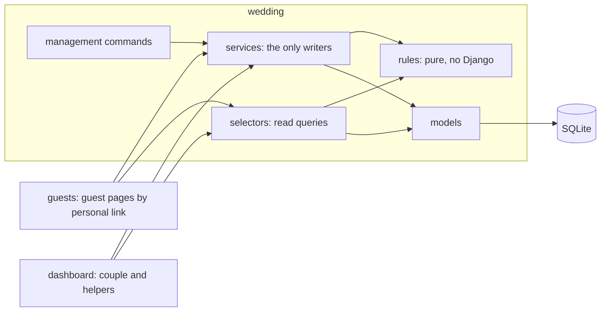
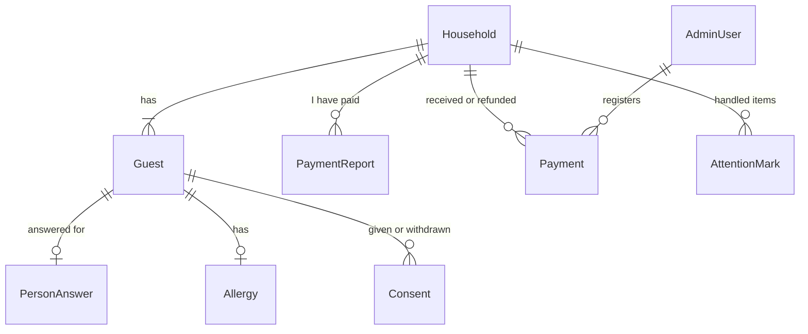
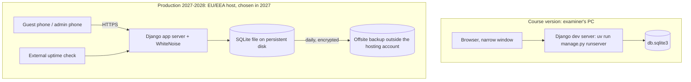

# Architecture Spine: AI'll handle it

Every decision below is explained in [.memlog.md](.memlog.md). This file holds only the rules.

## Design Paradigm

**Functional core, imperative shell, inside one server-rendered Django monolith.**

- **Core:** `wedding/rules/` is pure Python with no Django and no database. It decides which questions apply, totals, counts, payment status and the deadline lock.
- **Shell:** `wedding/services/` is the only code that writes. `guests/` and `dashboard/` are thin views and templates that render HTML.



Arrows show who may depend on whom. `guests` and `dashboard` never import each other, and `rules` imports nothing from the project.

## Invariants & Rules

### AD-1: One server-rendered Django monolith

- **Binds:** all
- **Prevents:** part of the app built as a JSON API with a JavaScript front end and part as server pages.
- **Rule:** Every page is a Django template rendered on the server. There is no separate front-end app, no JSON API for the site's own pages and no Node build step.

### AD-2: The counting rules live only in `wedding/rules/`

- **Binds:** FR-15, FR-33, FR-36, FR-41, FR-42, FR-54–FR-56, FR-60, FR-61, FR-70, FR-73–FR-75, NFR-2
- **Prevents:** the guest page and the admin summary computing a total, a count or a status in two places that drift apart.
- **Rule:** Any question that applies to a person, any total, count, payment status, payment-report match or lock state is computed by a function in `wedding/rules/`. Those functions take plain values and return plain values, with no Django or database imports. Views, templates, selectors and services call them and never re-implement them.

### AD-3: Services are the only writers

- **Binds:** all writes
- **Prevents:** two units changing the same data along different paths, for example one setting "Changed" and another forgetting to.
- **Rule:** Only functions in `wedding/services/` create, change or delete model rows. Each service is one `transaction.atomic()` block and applies the side effects that belong to the write, such as the "Changed" marker (FR-39) or deleting allergies on withdrawal (FR-30). Views and management commands call services and never call `.save()` or `.delete()` themselves.

### AD-4: Facts are stored, derived values are not

- **Binds:** NFR-2, FR-33, FR-60
- **Prevents:** a stored total or status disagreeing with the answers and payments behind it.
- **Rule:** Store only what people enter and what the couple marks. That covers households, guests, answers, allergies, consents, "I have paid" reports, registered payments and refunds, settings (prices, deadline, contacts, payment details), the "Changed" marker and "Needs attention" handled marks. Never store totals, counts, payment status, lock state or report matches; compute them under AD-2.

### AD-5: SQLite everywhere, through the ORM only

- **Binds:** all data access, NFR-8
- **Prevents:** tests passing on one engine while production runs another, and raw SQL that ties the code to one engine.
- **Rule:** SQLite is the database in the course version and in production. Its options are WAL journal and a busy timeout through `init_command`, `transaction_mode: IMMEDIATE`, and no `ATOMIC_REQUESTS`. All queries go through the Django ORM, with no raw SQL, so a later move to PostgreSQL is only a settings change.

### AD-6: Personal links

- **Binds:** FR-1–FR-6, FR-51–FR-53, NFR-1, NFR-4, PRD D14
- **Prevents:** links in different formats, codes that can be guessed, and more than one way to turn a code into a guest.
- **Rule:**
  - **Code:** each guest has one active code from `secrets.token_urlsafe(16)` (128 bits, 22 URL-safe characters). It is stored in plain form, unique and indexed, so the couple can copy it at any time.
  - **New link:** issuing a new link replaces only that guest's code, and the old code becomes unknown.
  - **Resolver:** one function in `wedding/` turns a code into a guest and household. Every guest view uses it.
  - **URL:** the link is `/<code>/` and every guest page lives under it. This format never changes once invitations go out.
  - **Without a valid link:** an unknown code or the bare `/` shows the FR-5 page and nothing more.
  - **Opening a link:** a GET request never writes (FR-3).

### AD-7: The RSVP form is server-rendered steps that work without JavaScript

- **Binds:** FR-12–FR-24, FR-70, FR-78, UX open question 4
- **Prevents:** a JavaScript copy of "which questions apply" or "what it costs" that drifts from the server's.
- **Rule:**
  - **Steps:** each step is a plain HTML form POSTed to the server. The server validates it, works out the next applicable step and the running total with `rules/`, and redirects (POST-redirect-GET).
  - **No JavaScript needed:** every guest page and every step works without JavaScript. Scripts only add enhancements, such as the FR-20 leave warning.
  - **Read more:** "Read more" inside a step is a `<details>` element.

### AD-8: An unsent answer lives only on the guest's device `[ADOPTED: UX open question 6]`

- **Binds:** FR-26, FR-28, FR-78, UX open question 6
- **Prevents:** one unit keeping drafts in the database while another keeps them in the browser, and allergy data reaching the server before consent.
- **Rule:**
  - **Where:** the draft is a signed, compressed cookie (`django.core.signing`) scoped to the path `/<code>/`. It holds everything entered, allergies included.
  - **When it goes away:** it expires at the RSVP deadline and is deleted on "Send answer" and on "Begynn på nytt".
  - **No early database write:** nothing about an unsent answer is written to the database. "Send answer" is the first write.
  - **Without consent:** on send without consent, allergy data is dropped (FR-28).
  - **Size:** the allergy note has a maximum length, and a test proves the draft for the largest household fits in 4 KB.

### AD-9: Two senders in one household never overwrite silently

- **Binds:** FR-38
- **Prevents:** one unit doing last-write-wins while another assumes a merge.
- **Rule:**
  - **Revision:** each household's sent answer has a revision number, and the draft records the revision it started from.
  - **Sending:** the send service checks the revision and writes in the same IMMEDIATE transaction.
  - **If the revision changed:** nothing is written. The guest sees the other answer (who, when and what differs) and must send again.

### AD-10: Roles are enforced on the server, in services

- **Binds:** FR-46, FR-47, FR-63, FR-64, NFR-4
- **Prevents:** a helper changing data through a forged form, and permission checks that live in some views but not others.
- **Rule:**
  - **Guests:** guests are not Django users. A request counts as a guest request only through AD-6.
  - **Admin users:** each admin user is a Django user with exactly one role, `couple` or `helper`.
  - **Writes:** every service that writes on behalf of an admin checks the `couple` role itself. Helper pages render read-only, and a hidden button is not the protection.
  - **Accounts:** admin accounts are created only by a management command (FR-47).

### AD-11: One deadline function, Norwegian time

- **Binds:** FR-41, FR-42, FR-63, SM-11
- **Prevents:** the guest page and a service disagreeing about whether the deadline has passed.
- **Rule:**
  - **Time:** `USE_TZ = True`, times are stored in UTC and shown in `Europe/Oslo`.
  - **Deadline:** the deadline is stored as a date, and one function in `rules/` decides whether a moment is after 23:59:59 Oslo time on that date.
  - **Lock checks:** every lock check, in guest views and in services, calls that function.
  - **Couple:** couple overrides (FR-63) skip the lock in the service, not in the view.

### AD-12: Money is whole kroner as integers

- **Binds:** FR-32–FR-36, FR-59–FR-61, NFR-2
- **Prevents:** rounding differences between units.
- **Rule:** Every amount, price and total is an `int` of whole kroner, in models, rules, forms and tests.

### AD-13: Admin sessions last 20 hours without use `[ADOPTED: UX open question 5]`

- **Binds:** NFR-4, UX open question 5
- **Prevents:** different session lengths or expiry warnings in different parts of the admin area.
- **Rule:**
  - **Expiry:** `SESSION_COOKIE_AGE` is 20 hours and `SESSION_SAVE_EVERY_REQUEST` is on, so every request renews the session.
  - **No warning:** there is no expiry warning and no restore of unsaved input.
  - **Logging out:** every admin page has a "Logg ut" button.

### AD-14: Runs with zero configuration and guards production

- **Binds:** NFR-4, NFR-8, NFR-9, FR-72
- **Prevents:** the examiner needing keys, and test data or debug settings reaching the real site.
- **Rule:**
  - **Settings:** all settings come from environment variables with safe local defaults, so the app runs with no `.env` file.
  - **Production:** `APP_ENV` is `local` or `production`. With `production`, the app refuses to start if `DEBUG` is on, `SECRET_KEY` is the default or `ALLOWED_HOSTS` is empty.
  - **Test data:** the seed command refuses to run in production.
  - **Example file:** `.env.example` lists every variable, with no real values.

### AD-15: Guest pages share nothing with other companies

- **Binds:** FR-4, NFR-3, NFR-4, PRD 3.2 (privacy in operation)
- **Prevents:** a font, script or link that leaks a guest's visit or link to a third party.
- **Rule:**
  - **Assets:** all fonts, scripts, images and CSS are served from the site itself.
  - **Headers:** every guest response sends `noindex` (meta and `X-Robots-Tag`) and `Referrer-Policy: no-referrer`, and has a page title with no names.
  - **Logs:** no names, link codes or allergy content are written to logs.

### AD-16: The expected-results list is the test oracle

- **Binds:** FR-68, FR-69, SM-2, NFR-2
- **Prevents:** tests that check numbers computed by the same code they are testing.
- **Rule:**
  - **The oracle:** the expected-results list is a committed data file next to the seed data, and it is written by hand before the code it checks.
  - **What the tests check:** they load the seed data and assert every count, total, payment status and the lock against that file.
  - **Changing the oracle:** changing it is a deliberate commit with a reason.

### AD-17: Info-page text becomes editable in 2027, as plain text `[ADOPTED: PRD D12]`

- **Binds:** FR-9, FR-10, FR-64, PRD D12
- **Prevents:** an edit that breaks the design or injects script.
- **Rule:**
  - **Course version:** in v1 the text lives in the templates.
  - **2027:** each section of Programme, Practical information and Our story gets one plain-text field in the database. Only the couple can edit it.
  - **Rendering:** the text is shown escaped, with only paragraph breaks kept, so no HTML or Markdown is possible.
  - **Fixed in code:** pictures, order and layout stay in the code.

## Consistency Conventions

| Concern | Convention |
| --- | --- |
| Language | Code, identifiers and comments are in English. Everything a user sees, including error messages, is in Norwegian bokmål (NFR-6). URL paths are in Norwegian. |
| Naming | Models are singular nouns (`Household`, `Guest`, `Consent`). Services are verbs (`send_answer`, `register_payment`, `withdraw_consent`). Rule functions are named for what they return (`household_total`, `payment_status`, `is_locked`). |
| Requirement links | Every rule function, service and test names the FR or NFR it implements in its docstring (NFR-9). |
| Errors | Services raise their own exception types. Views catch them and show a message next to the field or at the top, as FR-22 describes. A failed save keeps what the guest entered (NFR-1). |
| Forms | Django forms with CSRF on every POST. Validation that depends on other answers comes from `rules/` (FR-70). |
| Settings | Everything that differs between local and production is an environment variable listed in `.env.example`. |
| Style | Ruff for linting and formatting Python, djLint for templates, and both run before every commit. |
| Assets | One CSS file with the DESIGN.md tokens as CSS custom properties, and small vanilla JavaScript files. No build step. |

## Stack

| Name | Version |
| --- | --- |
| Python | 3.14 |
| uv (Python and package manager) | 0.12 |
| Django | 6.1.x (upgrade to 6.2 LTS before production: issue #13) |
| SQLite | the version bundled with Python (Django requires 3.31 or newer) |
| WhiteNoise (static files in production) | 6.12 |
| pytest + pytest-django | 9.2 + 4.14 |
| Ruff | 0.17 |
| djLint | 1.50 |

## Structural Seed

```text
<repo root>/
  pyproject.toml, uv.lock     # dependencies; run everything through uv
  manage.py
  .env.example
  config/                     # settings, root urls, wsgi
  wedding/
    models.py                 # all models (the data owner)
    rules/                    # pure functions: totals, counts, status, lock, applicable questions
    services/                 # the only writers
    selectors.py              # read queries for views
    links.py                  # the one code -> guest resolver (AD-6)
    management/commands/      # seed test data, create admin users
    fixtures/                 # seed data + expected-results list (AD-16)
  guests/                     # guest views, forms, templates under /<code>/
  dashboard/                  # admin views and templates under /admin/
  static/                     # css/, js/, fonts/, img/ (all self-hosted)
  tests/                      # pytest: rules, services, guest flow, admin, expected results
```

Core entities. Names and relationships only; the code owns the fields. `Settings` is a single row with prices, deadline, contacts and payment details.



Environments:



## Capability → Architecture Map

| Capability / Area | Lives in | Governed by |
| --- | --- | --- |
| Personal links and access (FR-1–FR-6) | `wedding/links.py`, `guests/` | AD-6, AD-15 |
| Invitation and info pages (FR-7–FR-11) | `guests/` templates | AD-1, AD-15, AD-17 |
| RSVP form (FR-12–FR-24, FR-70, FR-78) | `guests/`, `wedding/rules/`, `wedding/services/` | AD-2, AD-7, AD-8, AD-9 |
| Allergies and consent (FR-25–FR-31) | `wedding/services/`, `guests/` | AD-3, AD-8 |
| Prices, totals and payment for guests (FR-32–FR-36, FR-71) | `wedding/rules/`, `guests/` | AD-2, AD-4, AD-12 |
| Changing answers, deadline and lock (FR-37–FR-42) | `wedding/rules/`, `wedding/services/` | AD-9, AD-11 |
| Admin access and roles (FR-46–FR-48) | `dashboard/`, `wedding/management/commands/` | AD-10, AD-13 |
| Guest list and links (FR-49–FR-53, FR-76) | `dashboard/`, `wedding/services/` | AD-3, AD-6 |
| Overview and "Needs attention" (FR-54–FR-58, FR-77) | `dashboard/`, `wedding/selectors.py`, `wedding/rules/` | AD-2, AD-4 |
| Payments (FR-59–FR-62) | `wedding/services/`, `wedding/rules/` | AD-2, AD-4, AD-12 |
| Overrides and settings (FR-63–FR-65) | `dashboard/`, `wedding/services/` | AD-10, AD-11 |
| Privacy (FR-66, FR-67) | `guests/`, `wedding/services/` | AD-15 |
| Test data and expected results (FR-68, FR-69, FR-72) | `wedding/management/commands/`, `wedding/fixtures/`, `tests/` | AD-14, AD-16 |
| Counting rules (FR-73–FR-75) | `wedding/rules/` | AD-2 |
| Security (NFR-4) | `config/`, `wedding/links.py`, `wedding/services/` | AD-6, AD-10, AD-13, AD-14, AD-15 |

## Deferred

| Decision | Why it can wait | Decide when |
| --- | --- | --- |
| Hosting provider, app server, domain and HTTPS | Only production needs them. Constraints: EU/EEA, a persistent disk for the SQLite file, and a data processing agreement | 2027, before the ready date (1 November 2027) |
| Backup tooling and uptime monitoring | Production only. The constraints in PRD 3.2 bind: a daily encrypted copy outside the server and the hosting account, 30 days' retention, restore rehearsals and alerts to both | With hosting, 2027 |
| Upgrade to Django 6.2 LTS | 6.2 comes out on 6 April 2027, and 6.1 loses security support in December 2027 | Before going live; [issue #13](https://github.com/IBE160-2026/G26-dvergsdal/issues/13) |
| Change history (FR-40) and deleting all data (FR-67) | Marked [2027] in the PRD. Both must go through services (AD-3) | 2027 stories |
| Editable info pages (AD-17) | Production only | 2027 stories |
| Throttling details | One shared limiter on Django's database cache, for failed logins (tier 2) and unknown link codes (tier 3) | The story that builds login |
| Browser tests (for example Playwright) | Django's test client covers the server-rendered flow without JavaScript | If the scripted enhancements grow |
| A wider PC layout and an English version | "If time" in the PRD (section 3.3) | After the ready date, if ever |
