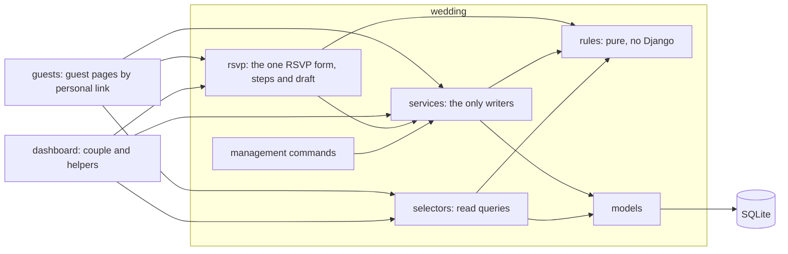
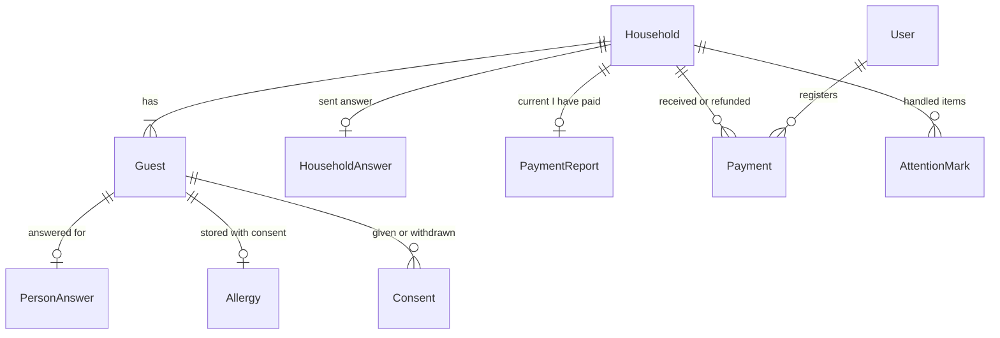
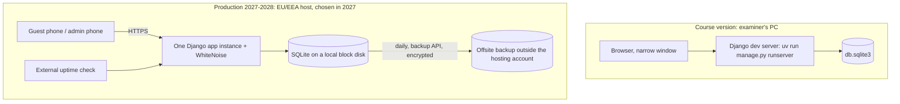

# Architecture Spine: AI'll handle it

Every decision below is explained in [.memlog.md](.memlog.md). The reviews that tested this spine are in [reviews/](reviews/). This file holds only the rules.

## Design Paradigm

**Functional core, imperative shell, inside one server-rendered Django monolith.**

- **Core:** `wedding/rules/` is pure Python with no Django and no database. It decides which questions apply, totals, counts, payment status, allergy state and the deadline lock.
- **Shell:** `wedding/services/` is the only code that writes. `wedding/rsvp/` is the one RSVP form. `guests/` and `dashboard/` are thin views and templates that render HTML.



Arrows show who may depend on whom. `guests` and `dashboard` never import each other. `rules` imports nothing from Django or the project, and a test checks this.

## Invariants & Rules

### AD-1: One server-rendered Django monolith

- **Binds:** all
- **Prevents:** part of the app built as a JSON API with a JavaScript front end and part as server pages.
- **Rule:**
  - **Pages:** every page is a Django template rendered on the server. There is no separate front-end app and no Node build step.
  - **Without JavaScript:** guest pages and admin pages work fully without JavaScript. Scripts only enhance.
  - **The one fragment endpoint:** the only endpoint that is not a full page is the running total (AD-7).

### AD-2: The rules live only in `wedding/rules/`

- **Binds:** FR-15, FR-33, FR-36, FR-41, FR-42, FR-54–FR-56, FR-60, FR-61, FR-70, FR-71, FR-73–FR-75, NFR-2
- **Prevents:** the guest page and the admin summary computing a total, a count or a status in two places that drift apart, and a count that disagrees with the list behind it.
- **Rule:**
  - **What lives there:** functions that decide which questions apply, every total, every count, payment status, guest balance, allergy state (AD-18), payment-report match, lock state, the derived payment message and `normalise_answer` (FR-75). *(Added 2026-11-23 in Story 2.2: the day rules are `day_error`, `can_stay_overnight` and `offered_meals` in `wedding/rules/days.py`, with the day keys `fri`/`sat`/`sun` and the meal keys of `programme_prices`; `normalise_answer` is in `wedding/rules/answer.py` and so far removes days for people who stop coming (Story 2.3 extends it with overnight stay and meals). `form_steps` takes the days, and `first_unfinished` says which step a later address must send the guest back to.)* *(Added 2026-11-23 in Story 2.3: `rules/answer.py` has the plain `Answer` value, `present_days` and `normalise_answer(Answer) -> Answer`, which also drops overnight stays and meals the days no longer allow; `rules/money.py` has `CABIN` and `household_total`, the only total.)* *(Added 2026-11-23 in Story 2.4: `rules/allergies.py` has `ALLERGY_KEYS`, `NOTE_MAX`, `AllergyEntry`, `has_allergy_info` («Ingen …» counts), `allergy_problems` (`CONFLICT`, `CONFIRM`) and `not_saved` (FR-28, reused by the check page in Story 2.5); `Answer` gains `allergies`, `consent` and `confirmed`, which `normalise_answer` drops for anyone not coming.)*
  - **Plain values:** they take plain values, including `now` when time matters, and return plain values.
  - **Counts are lists:** a count is the length of a list of guest or household ids returned by a rule, so the FR-55 drill-down shows exactly the counted people. Selectors load facts; they never filter on answer content.
  - **No copies:** views, templates, selectors, services and scripts call these functions and never re-implement them.

### AD-3: Services are the only writers, and every write names its actor

- **Binds:** all writes, FR-12, FR-29, FR-31, FR-39, FR-63
- **Prevents:** two units changing the same data along different paths, a write that records the wrong author, and a forged form that writes into another household.
- **Rule:**
  - **Only services write:** only functions in `wedding/services/` create, change or delete rows. Views and management commands call services and never call `.save()` or `.delete()` themselves.
  - **One transaction:** each service is one `transaction.atomic()` block and applies the side effects that belong to the write, such as the "Changed" marker (AD-19) or deleting allergies on withdrawal (FR-30).
  - **Actor:** each service takes an explicit `actor`: a guest actor (guest and household, from AD-6), an admin actor (user and role), or the system actor used only by the seed command. Never the request. The actor is what is recorded as "sent by", "consent given by" and "registered by".
  - **Own household only:** a guest service refuses any id outside the actor's household. Every write service has a test for the cross-household case.

### AD-4: Facts are stored, derived values are not

- **Binds:** NFR-2, FR-24, FR-33, FR-35, FR-59–FR-61, FR-71
- **Prevents:** a stored total or status disagreeing with the answers and payments behind it, and two stories choosing different shapes for the same fact.
- **Rule:**
  - **Stored:** households, guests, per-person answers, allergies and consent records, the household's revision (`Household.revision`, AD-9), the household's answer record (`HouseholdAnswer`: sent by, sent at), one current "I have paid" report per household (a correction replaces it), registered payments, settings, `Household.changed_at`, "Needs attention" handled marks, submission ids (AD-20), the `is_test_data` marker on households and users (AD-16), and the payment message only when the couple has adjusted it. *(Changed 2026-11-16 in Story 1.3: `is_test_data` added.)* *(Added 2026-11-24 in Story 2.6a: `HouseholdAnswer` has `household` (one-to-one), `sent_by` (the respondent guest, set to null if the guest is removed), `sent_by_name` (the name as text, kept) and `sent_at`; `PersonAnswer` has `guest` (one-to-one), `coming`, `friday`/`saturday`/`sunday`, `cabin`, `friday_dinner`/`saturday_breakfast`/`sunday_breakfast` and `hike` (blank when not asked). Migration `0005`. The person and household states of FR-74 are derived by `person_state` and `household_state` in `rules/households.py`.)* *(Added 2026-11-24 in Story 2.6b: `Allergy` has `guest` (one-to-one), one boolean per `ALLERGY_KEYS` category, `none` («Ingen allergier eller matbehov») and `note`; `Consent` is append-only with `guest`, `event` (`given`, `refused`, `withdrawn`), `at`, `given_by` (the respondent guest, null if removed), `given_by_user` (the couple's override in Story 4.4), `given_by_name` (kept as text) and `text_version`. Migration `0006`.)*
  - **Payments:** each payment row has a kind (`received` or `refunded`) and a positive whole-kroner amount. Undo sets `voided_at`; payment rows are never deleted.
  - **Never stored:** totals, counts, payment status, guest balance, allergy state, lock state, report matches, the derived payment message and its duplicate warning. These are always computed under AD-2.
  - **Deletes:** a household or guest with payments cannot be deleted until the payments are voided. Deleting a guest removes that guest's answers, allergies and consent records.

### AD-5: SQLite everywhere, through the ORM only

- **Binds:** all data access, NFR-8, PRD 3.2
- **Prevents:** tests passing on one engine while production runs another, raw SQL that ties the code to one engine, and a backup that silently misses committed data.
- **Rule:**
  - **One engine:** SQLite in the course version and in production.
  - **Options:** `timeout` for the busy timeout, WAL journal through `init_command`, `transaction_mode: IMMEDIATE`, short transactions and no `ATOMIC_REQUESTS`.
  - **ORM only:** all queries go through the Django ORM, with no raw SQL, so a later move to PostgreSQL is only a settings change.
  - **Production:** exactly one app instance on a local block disk, never a network file system. Backups use SQLite's backup API (`.backup` or `VACUUM INTO`), never a copy of the live file.

### AD-6: Personal links

- **Binds:** FR-1–FR-6, FR-51–FR-53, NFR-1, NFR-4, PRD D14
- **Prevents:** links in different formats, codes that can be guessed, more than one way to turn a code into a guest, and codes leaking to people or places that should not see them.
- **Rule:**
  - **Code:** each guest has one active code from `secrets.token_urlsafe(16)` (128 bits, 22 URL-safe characters). It is stored in plain form, unique and indexed, so the couple can copy it at any time. Only the seed command may set fixed codes, in the same 22-character format.
  - **New link:** issuing a new link replaces only that guest's code; the old code becomes unknown.
  - **Resolver:** one function in `wedding/` turns a code into a guest actor. Every guest view uses it.
  - **URL:** the link is `/<code>/` and every guest page lives under it. This format never changes once invitations go out. The info pages are `/<code>/program/`, `/<code>/praktisk/` and `/<code>/historie/`; `/<code>/svar/` (the RSVP form, AD-7) and `/<code>/personvern/` follow. *(Added 2026-11-20 in Story 1.5: the paths were decided in the architecture memlog but not written into this rule; Story 1.5 adds the first three, and Stories 2.1 and 7.1 add `/svar/` and `/personvern/`.)*
  - **Without a valid link:** an unknown code or the bare `/` shows the FR-5 page and nothing more.
  - **Opening a link:** a GET request never writes (FR-3).
  - **Who sees codes:** codes and "Kopier lenke" are rendered only for the couple, never for helpers.

### AD-7: One RSVP form, server-rendered steps

- **Binds:** FR-12–FR-24, FR-32, FR-33, FR-63, FR-70, UX open question 4
- **Prevents:** a copy of the form for the couple, and a JavaScript copy of "which questions apply" or "what it costs" that drifts from the server's.
- **Rule:**
  - **One form, mounted twice:** step forms, step order, templates and draft handling live in `wedding/rsvp/`. It is mounted at `/<code>/svar/` for guests and at `/admin/husstand/<id>/svar/` for the couple's override, with the actor passed in.
  - **Steps:** each step is a plain HTML form POSTed to the server. The server validates it, works out the next applicable step and the total with `rules/`, saves the draft and redirects (POST-redirect-GET). A step with errors re-renders with status 200 instead of redirecting. *(Changed 2026-11-21 in Story 2.1: a step with errors uses POST-redirect-GET too. The valid choices go into the draft, step 1 stays not done, and the browser is sent with 303 to the step's address with `?feil=1`, whose GET shows the errors. A page that is a POST response cannot be reached with Back without a resubmit prompt (`net::ERR_CACHE_MISS` in Edge), and the story's AC says Back works without one.)*
  - **Running total:** the server renders the total on every step. As an enhancement, `POST /<code>/svar/sum/` (and the same under the admin path) returns the total as a server-rendered HTML fragment for a script to swap in on change. It uses the same rule and writes nothing.
  - **Price change before sending:** the draft stores the total shown on the check page. If the recomputed total differs at send, nothing is written and the check page is shown again with a notice. *(Changed 2026-11-24 in Story 2.6a: the snapshot and the comparison move to Story 2.6c, which owns «the recalculated total differs → refuse». Storing it in 2.6a would add a draft field nothing reads, and writing it on the check page's GET would break AD-8's «written only on Fortsett or Velg».)*
  - **Read more:** "Read more" inside a step is a `<details>` element.
  - **Send:** *(Added 2026-11-24 in Story 2.6a: «Send svaret» posts `action=send` to the check page. After the same gate as a GET, the view calls `send_answer` (`wedding/services/answers.py`) with the mount's actor, deletes the draft cookie and redirects (303) to `<base>/sendt/` (`FormMount.sent_url()`), the sent page that Story 2.7 turns into the receipt. A POST without `action=send` redirects back and writes nothing. `DeadlinePassed` from the service shows the closed page. A CSRF failure on a finished check page shows it again with status 403 and the focused notice.)*
  - **Addresses:** *(Added 2026-11-21 in Story 2.1: step 1 is the base address `/<code>/svar/`, and the later steps are `/<code>/svar/<slug>/` with the slugs `dager`, `overnatting`, `maltider`, `allergier` and `fjelltur`, and the check page `se-over`. The registry (key, slug, name) is `wedding/rsvp/steps.py`, and the applicable steps come from `form_steps` in `wedding/rules/form_steps.py`. A `FormMount` carries the base path, the draft's cookie path and where «Tilbake» on step 1 goes, so the couple's mount (Story 4.4) builds its own addresses. Until Stories 2.2–2.5 fill them, the later steps and the check page are frames, so «Fortsett» always lands on a real address. «Bytt» is a `<details>` too, and its «Velg» posts the whole step with `action=switch`.)* *(Added 2026-11-23 in Story 2.2: step 2 is one address, `dager/`. Without JavaScript «Nei» must reach the server before the day groups can appear, so «Nei» the first time saves «Nei» and redirects to `dager/#velg-dager`, where the same page shows one day group per coming person; this is not an error. A later step or the check page redirects to the first applicable step before it that is not done (`first_unfinished`), so no step is reached with an unanswered one before it. The registry also holds each step's question (`Step.question`) and the days with their dates (`DAYS`), the only place the form holds dates.)* *(Added 2026-11-23 in Story 2.3: the running total is `POST /<code>/svar/sum/?steg=<overnatting|maltider>`; it answers the total fragment, or 204 after the deadline, without a usable draft or for any other step, and never sets a cookie. The visible total is in the page at load and is not a live region; an empty `role="status"` beside it gets the text. When a draft write changes `present_days`, the steps after step 2 leave `done`.)*
  - *(Added 2026-11-23 in Story 2.5: the check page's «Endre» links add `?fra=se-over` (`FROM_QUERY`, only the value `se-over` counts). A step opened that way keeps `fra` on its error, «Velg» and `#velg-dager` redirects, its «Tilbake» goes to the check page, and a valid «Fortsett» goes to the first unfinished step or the check page instead of the next step; when the change reopened later steps, the check page's own gate sends the guest to the first of them. The query is navigation, not an answer, so no hidden field is needed. A POST to the check page redirects back and writes nothing until Story 2.6a.)*

### AD-8: An unsent answer lives in a draft cookie and is never stored `[ADOPTED: UX open question 6]`

- **Binds:** FR-26, FR-28, FR-78, UX open question 6
- **Prevents:** one unit keeping drafts in the session or database while another keeps them in the browser, and allergy data stored before consent.
- **Rule:**
  - **The only home:** between steps, answers live only in the draft: a cookie with `signing.dumps(..., compress=True)` set by `set_cookie`, `HttpOnly`, `SameSite=Lax` and `Secure` in production. For guests it is scoped to the guest's own path `/<code>/`, so the front page can see that a draft exists; for the couple's override it is scoped to the admin override path. No session, hidden fields or database rows hold answers before send. *(Changed 2026-11-16 after the epics review, `../../reviews/review-epics-2026-11-16.md` A1/E1: the first rule scoped the guest cookie to `/<code>/svar/`, and browsers never send such a cookie to the front page `/<code>/`, so the draft notice in FR-78 and UX-DR26 could never appear.)*
  - **A broken draft:** a draft with a bad signature, that fails to decompress or that no longer matches the household (a guest removed, moved or added since it started) is deleted, and the form starts from the sent answer or empty. It never causes a server error.
  - **What it holds:** everything entered, allergies included, plus the household revision it started from and when it was started.
  - **Not stored before send:** the server receives each step but stores nothing until "Send answer". Allergy data is stored only with consent (AD-18).
  - **When it goes away:** it is deleted on "Send answer" and on "Begynn på nytt". Its expiry is only a backstop; the server decides with the deadline function whether a draft may be offered.
  - **Guest pages and sessions:** guest views never read or write `request.session` and never use the messages framework. A test asserts that the whole guest flow creates no session rows.
  - **Size:** the allergy note has a maximum length of 200 characters, and a test proves the draft for a household of 8 people with every field filled fits in 4 KB. A household larger than 8 is refused when the couple saves it. *(Changed 2026-11-16 after the epics review, A10/E17: without numbers the 4 KB test could not be written.)*
  - **No cookies:** a browser that blocks cookies also fails Django's CSRF check, and gets the friendly CSRF failure page (AD-15).
  - **Format:** *(Added 2026-11-21 in Story 2.1: the cookie is `rsvp_draft`, signed with the salt `wedding.rsvp.draft`, and its JSON payload is `{"v": 1, "started", "rev", "resp", "att", "done"}` (format 1: when it started in UTC, the household revision, the respondent's guest id, each member's attendance by guest id and the completed step keys). Wrong types, another version, or a respondent, member or step key the household does not know make it broken. Its `max_age` is 90 days, only a backstop. It is first written on «Fortsett» or «Velg», never on a GET. The code is `wedding/rsvp/draft.py`. A CSRF failure on a step re-renders the step with what was posted and writes no draft (UX-DR52).)* *(Changed 2026-11-23 in Story 2.2: format 2 adds `"whole": true|false|null` (the answer to «Er alle som kommer, med hele helgen?») and `"days": {"<guest id>": [day keys]}` (non-empty lists of distinct day keys, members only); anything else, and a format 1 cookie, is broken. Every draft write runs `normalise_answer`, and `done` keeps `days` only while «Ja» is chosen or every coming person's days are allowed, so a new comer or a removed day reopens step 2. Days that are not allowed are still saved, so the error page shows what the guest ticked; `done` is what protects the later steps.)* *(Added 2026-11-23 in Story 2.3: format 3 adds `"night": {"<id>": bool}` and `"meals": {"<id>": [meal keys]}`; a format 2 cookie is broken.)* *(Added 2026-11-23 in Story 2.4: format 4 adds `"alg": {"<id>": {"c": [categories], "n": bool, "t": note ≤ 200}}`, `"cons": {"<id>": bool}`, `"conf": [ids]` and `"long": [ids]` (whose last posted note was too long and was not kept); a format 3 cookie is broken. A full draft for 8 people with every category, a 200-character note with æøå, consent and confirmation for all measures 1 564 characters signed, so the default serializer is kept. «Nei» keeps the typed allergies in the draft: nothing is stored yet, so there is nothing to withdraw.)* *(Added 2026-11-23 in Story 2.5: format 5 adds `"hike": {"<id>": "yes"|"no"|"maybe"}` (`HIKE_ANSWERS` in `wedding/rules/days.py`), kept by `normalise_answer` only for a member present on Friday; a format 4 cookie is broken. The full draft for 8 with «Kanskje» for everyone measures 1 600 characters signed.)*

### AD-9: Two senders in one household never overwrite silently

- **Binds:** FR-38, FR-49, FR-50
- **Prevents:** one unit doing last-write-wins while another assumes a merge, and an old draft overwriting a newer change.
- **Rule:**
  - **Revision:** `Household.revision` (0 for a new household) goes up on every send, every couple override, every consent withdrawal and every time a guest is added, moved or removed. *(Changed 2026-11-16 after the epics review, E10: the revision lived on `HouseholdAnswer`, which does not exist before the first send, so adding a guest to a household that had not answered had nowhere to record the change.)*
  - **Sending:** the send service compares the draft's revision with the current one and writes in the same IMMEDIATE transaction.
  - **If the revision changed:** nothing is written. The guest sees the other answer (who, when and what differs) and must send again.

### AD-10: Roles are enforced on the server, in services

- **Binds:** FR-46, FR-47, FR-63, FR-64, NFR-4
- **Prevents:** a helper changing data through a forged form, permission checks in some views but not others, and a role field added after the first migration.
- **Rule:**
  - **User model:** `wedding.User(AbstractUser)` with `role` set to `couple` or `helper` is `AUTH_USER_MODEL` from the very first migration.
  - **Guests:** guests are not Django users. A request counts as a guest request only through AD-6, and guest views never read `request.user`.
  - **Writes:** every admin write service calls one `require_couple(actor)` check. Helper pages render read-only, but the service is the protection.
  - **Sessions:** the admin session cookie is scoped to `/admin/`.
  - **Accounts:** admin accounts are created only by a management command (FR-47).

### AD-11: One deadline function, and a fixed list of what it locks

- **Binds:** FR-30, FR-41, FR-42, FR-63, SM-11
- **Prevents:** two units disagreeing about whether the deadline has passed, and a story that wrongly locks consent withdrawal or payment reports.
- **Rule:**
  - **Time:** `USE_TZ = True`, `TIME_ZONE = "Europe/Oslo"`. Times are stored in UTC and shown in Oslo time.
  - **Deadline:** the deadline is stored as a date. One function in `rules/`, given `now`, decides whether a moment is after 23:59:59 Oslo time on that date. Tests cover both sides of it and a winter/summer time boundary. *(Added 2026-11-21 in Story 2.1: the function is `is_past_deadline(deadline, now)` in `wedding/rules/deadline.py`. It is True from 00:00:00 Europe/Oslo the day after, and refuses a naive `now`. Every step address under `/<code>/svar/` checks it first (an unknown slug stays 404), also when a POST fails the CSRF check, and after the deadline shows a closed page that writes nothing.)*
  - **What it locks:** only guest sends that change answer content. Consent withdrawal, "I have paid" reports and every couple service are never locked.

### AD-12: Money is whole kroner as integers

- **Binds:** FR-32–FR-36, FR-59–FR-61, NFR-2
- **Prevents:** rounding differences between units, and guests seeing the couple's private registrations.
- **Rule:**
  - **Integers:** every amount, price and total is an `int` of whole kroner, in models, rules, forms and tests.
  - **Two money views:** `guest_balance(total, report)` is the only money function guest pages use. `payment_status(total, received, refunded)` is admin-only. Guest views and templates never read payment rows (PRD 3.4).

### AD-13: Admin sessions last 20 hours without use `[ADOPTED: UX open question 5]`

- **Binds:** NFR-4, UX open question 5
- **Prevents:** different session lengths or expiry warnings in different parts of the admin area.
- **Rule:**
  - **Expiry:** `SESSION_COOKIE_AGE` is 20 hours and `SESSION_SAVE_EVERY_REQUEST` is on, so every request renews the session.
  - **No warning:** there is no expiry warning and no restore of unsaved input.
  - **Logging out:** every admin page has a "Logg ut" button.

### AD-14: Runs with zero configuration and guards production

- **Binds:** NFR-4, NFR-8, NFR-9, FR-72
- **Prevents:** the examiner needing keys or the wrong Python, and test data or debug settings reaching the real site.
- **Rule:**
  - **Settings:** all settings come from environment variables with safe local defaults, so the app runs with no `.env` file. `.env.example` lists every variable with no real values.
  - **Python:** `.python-version` is `3.14`, and `requires-python` is `>=3.14,<3.15`.
  - **Production:** `APP_ENV` is `local` or `production`. With `production`, the app refuses to start if `DEBUG` is on, `SECRET_KEY` is the default or `ALLOWED_HOSTS` is empty.
  - **Test data:** the seed command runs only when `APP_ENV` is `local` (the default when it is not set, so the examiner needs no `.env`); any other value, including a misspelled one, makes it refuse (an allow list, so `prod` or `Production` on a server can never let it through).

### AD-15: Guest visits and links stay private

- **Binds:** FR-4–FR-6, NFR-3, NFR-4, PRD 3.2 (privacy in operation)
- **Prevents:** a font, script, header or log line that leaks a guest's visit, link or allergy data.
- **Rule:**
  - **Assets:** all fonts, scripts, images and CSS are served from the site itself.
  - **Headers:** every guest response sends `noindex` (meta and an `X-Robots-Tag` middleware) and `Referrer-Policy: same-origin`, and has a page title with no names. External links carry `rel="noreferrer"`. A test checks the headers. (`no-referrer` is not allowed: it makes Django's CSRF check reject every form.) *(Changed 2026-11-20 in Story 1.4c: `/robots.txt` blocks nothing (`Disallow:` empty), because a crawler that may not fetch a page never reads its `noindex` and may still list the bare URL; it exists to say so and to stop `/robots.txt` from showing G1. The link preview is one fixed set of Open Graph tags in `base.html`, outside every block, and `og:image` is absolute from the request's own host (no `SITE_URL` setting, NFR-8). Behind TLS on a host this needs `SECURE_PROXY_SSL_HEADER`, or the image URL says `http://`.)*
  - **Logs:** a logging filter masks link codes in request paths. Guest form views use `sensitive_post_parameters`. No names, codes or allergy content are written to logs. Production access logs must mask the code too.
  - **Error pages:** 404, 500 and CSRF failure pages under `/<code>/` show the couple's contact numbers when the code resolves, and nothing personal otherwise. *(Changed 2026-11-21 in Story 1.8: the handlers (`handler404`, `handler500`, `handler400` in `config/urls.py` and `CSRF_FAILURE_VIEW`) live in `guests/views.py` and look the first path segment up through the one resolver. A 400 is always impersonal and never looks the code up, since the request itself is untrusted. The 400 and 500 pages render without a request, so the link preview leaves out `og:image` and nothing calls `request.get_host`, which would raise `DisallowedHost` again. Any failure in the lookup falls back to the impersonal page, so an error page never fails itself. The handlers are site-wide, so `/admin/` paths get the impersonal guest pages until Story 3.1 decides the couple's own.)*

### AD-16: The expected-results list is the test oracle

- **Binds:** FR-68, FR-69, FR-72, SM-2, NFR-2
- **Prevents:** tests that check numbers computed by the same code they are testing, and seed data that skips the rules every other write follows.
- **Rule:**
  - **Files:** the seed data and the expected-results list are TOML files in `wedding/fixtures/`, read with Python's `tomllib`. The expected results are written by hand before the code they check.
  - **Seeding:** the seed command builds its data by calling services with the system actor. It sets the deadline relative to the seeding day, so the examiner meets an open form. All data is clearly fake: `example.com` emails, phone numbers that cannot be real and an account number with an invalid check digit.
  - **Marker:** a household or admin user created by the system actor gets `is_test_data=True` (guests belong to their household). Before seeding, a reset service with the system actor deletes the marked households with everything in them (including a guest added to one later) and the marked users, so the command can run again and never deletes a household or user it did not make. If a seed link code or username is already used by an unmarked row, the command stops before writing anything. Real admin accounts (Story 3.1's `create_admin`) are made with `is_test_data=False` through their own path, never with the system actor, so a later seed cannot delete them. *(Added 2026-11-16 in Story 1.3: matching the seed codes and usernames could not tell a test user from a real user with the same name, and old seed households would be left behind if a code changed. The system actor is used only by the seed command (AD-3), so "created by the system actor" is the same as "test data".)*
  - **Tests:** they load the seed data and assert every count, total, payment status, allergy state and the lock against the expected results, passing `now` explicitly.
  - **Changing the oracle:** changing it is a deliberate commit with a reason.

### AD-17: Info-page text becomes editable in 2027, as plain text `[ADOPTED: PRD D12]`

- **Binds:** FR-9, FR-10, FR-64, PRD D12
- **Prevents:** an edit that breaks the design or injects script.
- **Rule:**
  - **Course version:** in v1 the text lives in the templates.
  - **2027:** each section of Programme, Practical information and Our story gets one plain-text field in the database. Only the couple can edit it.
  - **Rendering:** the text is shown escaped, with only paragraph breaks kept, so no HTML or Markdown is possible.
  - **Fixed in code:** pictures, order and layout stay in the code.

### AD-18: Allergy and consent states `[ADOPTED: Rikke 2026-11-16]`

- **Binds:** FR-25–FR-31, FR-54, FR-56, FR-58, NFR-3
- **Prevents:** a re-send that silently deletes consented allergies, an old draft storing a withdrawn allergy again, and admin counts that mix up "answered without consent" and "not answered" differently in different places.
- **Rule:**
  - **Consent needed for both:** allergy categories and notes, and "Ingen allergier eller matbehov", are stored only with consent.
  - **Three outcomes on any send:** for each person, consent is *unchanged*, *given* or *refused*. An unanswered consent on a re-send means unchanged, so existing consented data is kept. A draft never carries a consent "Ja" across a revision change.
  - **Withdrawal:** it deletes that person's allergy data, bumps the revision and marks the household changed.
  - **Consent-text version (FR-29):** the consent text lives in one template include, and its version is one constant, `CONSENT_TEXT_VERSION` in `wedding/services/`, set to the date the text last changed (for example `"2026-11-16"`). A change to the text changes the constant in the same commit, and every consent record stores the constant. *(Added 2026-11-16 after the sprint-planning readiness check: FR-29 asked for the version, but nothing said where it lives.)* *(Added 2026-11-23 in Story 2.4: the constant is `CONSENT_TEXT_VERSION = "2026-11-23"` in `wedding/services/consent.py`, the text is `rsvp/includes/consent_text.html`, and `tests/test_rsvp_allergies.py` pairs the version with the sha256 of the template, so a text change fails until both are updated.)* *(Added 2026-11-24 in Story 2.6b: `consent_outcomes` in `rules/allergies.py` gives each guest `STORE`, `DELETE` or `KEEP`, and `send_answer` applies it in its transaction. «Ja» with nothing entered deletes the stored row (the step's content is the truth once consent is answered); someone not coming has their data deleted with no consent event (FR-75, NFR-3). Each «Ja»/«Nei» of a coming guest adds one `Consent` row with the version current at send; recording the version the guest saw on step 5, and catching a text change before sending, moves to Story 2.6c together with the draft format bump for the total snapshot.)*
  - **Three admin states:** one rule function gives each coming guest exactly one state: *Har allergier eller matbehov*, *Ingen allergier eller matbehov*, or *Ingen allergiopplysninger lagret*. The last is one bucket on purpose: it covers not answered, answered without consent and withdrawn, because telling them apart would store a hint of a health need. Whether the household has answered is shown separately.

### AD-19: "Changed" and "Needs attention" have one source each

- **Binds:** FR-39, FR-56, FR-61
- **Prevents:** two stores for "Changed", and an item marked as seen that stays hidden after a new change.
- **Rule:**
  - **Changed:** `Household.changed_at` is set by one helper. Only these services call it: a guest or the couple changing a sent answer, and consent withdrawal.
  - **Attention items:** each item has a kind, a subject (guest or household) and an event time, all computed by rules.
  - **Handled marks:** a mark stores kind, subject and `handled_at`. The item shows again when its event time is later than `handled_at`.

### AD-20: Confirm, undo and repeat submits

- **Binds:** FR-59, FR-64, FR-65, FR-49, NFR-1
- **Prevents:** confirm dialogs built three ways, undo by deleting rows, and a double tap that saves twice.
- **Rule:**
  - **Confirm:** a confirmation is a first POST that previews the change with rule functions and writes nothing, rendered as server HTML (a script may show it as a dialog). The second POST calls the service.
  - **Undo:** undo is a service that reverses the write, such as voiding a payment, offered after the redirect by the id of what was written.
  - **Repeat submits:** every write form carries a one-time submission id. Every write service records it in one `Submission` row (the id under a unique constraint, the kind of write and the id of what was written) in the same transaction, whether the write creates rows or only updates them. The repeat check runs first, before the revision check in AD-9, so a repeat returns the earlier result instead of writing again: a double tap on «Send svaret», also on a re-send, shows the receipt and not a conflict with oneself, and a double «Registrer» stores one payment. A write that is refused (a revision conflict, a changed total or the deadline) records no `Submission`, so the guest's next try is handled as a new send. *(Changed 2026-11-16 after the sprint-planning readiness check: the first rule only covered writes that create a row, so a double tap on a re-send, which only updates `HouseholdAnswer`, would have hit the AD-9 revision check and shown a false conflict.)*

## Consistency Conventions

| Concern | Convention |
| --- | --- |
| Language | Code, identifiers and comments are in English. Everything a user sees, including error messages, is in Norwegian bokmål (NFR-6), with `LANGUAGE_CODE = "nb"`. URL paths are in Norwegian. |
| Naming | Models are singular nouns (`Household`, `Guest`, `HouseholdAnswer`, `Consent`). Services are verbs (`send_answer`, `register_payment`, `withdraw_consent`). Rule functions are named for what they return (`household_total`, `payment_status`, `guest_balance`, `allergy_state`, `is_locked`). |
| Requirement links | Every rule function, service and test names the FR or NFR it implements in its docstring (NFR-9). |
| Errors | Services raise their own exception types. Views catch them and show a message next to the field or at the top, as FR-22 describes. A failed save keeps what the guest entered (NFR-1). |
| Forms | Django forms with CSRF on every POST. Validation that depends on other answers comes from `rules/` (FR-70). |
| Accessibility | Templates follow NFR-5 and the patterns in EXPERIENCE.md: a label for every field, a `fieldset` and `legend` for every choice group, visible focus. |
| Settings | Everything that differs between local and production is an environment variable listed in `.env.example`. |
| Quality checks | Ruff for linting and formatting Python, djLint for templates. A GitHub Actions workflow runs `uv run pytest`, Ruff and djLint on every push and pull request. |
| Assets | One CSS file with the DESIGN.md tokens as CSS custom properties, small vanilla JavaScript files and self-hosted fonts. No build step. |

## Stack

| Name | Version |
| --- | --- |
| Python | 3.14 (pinned in `.python-version`) |
| uv (Python and package manager) | 0.13 (0.12 also works) |
| Django | 6.1.x (upgrade to 6.2 LTS before production: issue #13) |
| SQLite | the version bundled with Python (Django 6.1 requires 3.37 or newer) |
| WhiteNoise (static files in production) | 6.12 |
| pytest + pytest-django | 9.2 + 4.14 |
| Ruff | 0.17 |
| djLint | 1.50 (exact version locked in `uv.lock`) |

## Structural Seed

```text
<repo root>/
  pyproject.toml, uv.lock     # dependencies; run everything through uv
  .python-version             # 3.14
  manage.py
  .env.example
  .github/workflows/          # tests, Ruff and djLint on every push
  config/                     # settings, root urls, wsgi, middleware, logging filter
  wedding/
    models.py                 # all models (the data owner), incl. the custom User
    rules/                    # pure functions (AD-2)
    services/                 # the only writers (AD-3)
    rsvp/                     # the one RSVP form: steps, forms, templates, draft (AD-7, AD-8)
    selectors.py              # read queries for views
    actors.py                 # guest, admin and system actors that services take (AD-3)
    links.py                  # the one code -> guest actor resolver (AD-6)
    management/commands/      # seed test data, create admin users
    fixtures/                 # seed data + expected results, TOML (AD-16)
    templates/wedding/        # base.html and shared components (notice) every page uses
  guests/                     # guest views and templates under /<code>/
  dashboard/                  # admin views and templates under /admin/
  static/                     # css/, js/, fonts/, img/ (all self-hosted)
  tests/                      # pytest: rules, services, guest flow, admin, expected results
  tools/                      # developer scripts, never imported by the app (prepare_images.py)
```

*(Changed 2026-11-16 in Story 1.2: `wedding/actors.py` added. The guest actor is made by `links.py` and the admin and system actors by the views and the seed command, and every service takes one of them (AD-3), so the actor types live in one module that both sides import instead of inside `links.py` or `services/`.)*

*(Changed 2026-11-18 in Story 1.4a: `wedding/templates/wedding/` added. The guest pages, the couple's pages and the RSVP form in `wedding/rsvp/` all extend the same base template and use the same notice include, and `guests` and `dashboard` must not import each other, so the shared templates live with the shared app.)*

*(Changed 2026-11-20 in Story 1.4b: `tools/` added. `tools/prepare_images.py` makes the images in `static/img/` from Rikke's files, so a replaced image is one command away and the result can be checked against the size budget (NFR-7). It runs with `uvx --with pillow==13.0.0`, so Pillow never becomes a dependency of the app, and it does not belong in `static/`, which is served to visitors.)*

*(Changed 2026-11-21 in Story 2.1: the RSVP form's templates live in `wedding/rsvp/templates/rsvp/`. `wedding/rsvp/` is a package, not an app, so the folder is listed in `TEMPLATES["DIRS"]` in `config/settings.py`. The guest mount's views, the closed page after the deadline and the CSRF handler stay in `guests/`.)*

Core entities. Names and relationships only; the code owns the fields. `Settings` is a single row with prices, deadline, contacts and payment details.



Environments:



*(Changed 2026-11-23, Rikke's decision: the usability test in the first week of December 2026 runs locally on Rikke's machine with the course version and fictional test data, not on a public address. So the stricter log mask for link codes and the production hardening (AD-14, HTTPS, `CSRF_TRUSTED_ORIGINS`) are not needed before the test; they stay with the hosting story and go-live, see `deferred-work.md`.)*

## Capability → Architecture Map

| Capability / Area | Lives in | Governed by |
| --- | --- | --- |
| Personal links and access (FR-1–FR-6) | `wedding/links.py`, `guests/` | AD-6, AD-15 |
| Invitation and info pages (FR-7–FR-11) | `guests/` templates | AD-1, AD-15, AD-17 |
| RSVP form (FR-12–FR-24, FR-70, FR-78) | `wedding/rsvp/`, `wedding/rules/`, `wedding/services/` | AD-2, AD-7, AD-8, AD-9, AD-20 |
| Allergies and consent (FR-25–FR-31) | `wedding/rsvp/`, `wedding/services/`, `wedding/rules/` | AD-3, AD-8, AD-18 |
| Prices, totals and payment for guests (FR-32–FR-36, FR-71) | `wedding/rules/`, `guests/` | AD-2, AD-4, AD-12 |
| Changing answers, deadline and lock (FR-37–FR-42) | `wedding/rsvp/`, `wedding/rules/`, `wedding/services/` | AD-9, AD-11, AD-19 |
| Admin access and roles (FR-46–FR-48) | `dashboard/`, `wedding/management/commands/` | AD-10, AD-13 |
| Guest list and links (FR-49–FR-53, FR-76) | `dashboard/`, `wedding/services/` | AD-3, AD-6, AD-9, AD-20 |
| Overview and "Needs attention" (FR-54–FR-58, FR-77) | `dashboard/`, `wedding/selectors.py`, `wedding/rules/` | AD-2, AD-4, AD-18, AD-19 |
| Payments (FR-59–FR-62) | `wedding/services/`, `wedding/rules/` | AD-2, AD-4, AD-12, AD-20 |
| Overrides and settings (FR-63–FR-65) | `wedding/rsvp/` mounted in `dashboard/`, `wedding/services/` | AD-7, AD-10, AD-11, AD-20 |
| Privacy (FR-66, FR-67) | `guests/`, `wedding/services/` | AD-15, AD-18 |
| Test data and expected results (FR-68, FR-69, FR-72) | `wedding/management/commands/`, `wedding/fixtures/`, `tests/` | AD-14, AD-16 |
| Counting rules (FR-73–FR-75) | `wedding/rules/` | AD-2 |
| Security (NFR-4) | `config/`, `wedding/links.py`, `wedding/services/` | AD-3, AD-6, AD-10, AD-13, AD-14, AD-15 |

## Deferred

| Decision | Why it can wait | Decide when |
| --- | --- | --- |
| Hosting provider, app server, domain and HTTPS | Only production needs them. Bound by AD-5: EU/EEA, one instance, a local block disk, a data processing agreement and access logs that mask link codes | 2027, before the ready date (1 November 2027) |
| Backup tooling and uptime monitoring | Production only. Bound by AD-5 and PRD 3.2: a daily encrypted copy made with the backup API and kept outside the server and hosting account, 30 days' retention, restore rehearsals and alerts to both | With hosting, 2027 |
| How production errors reach the couple | Email and third-party services are ruled out, so Django's usual error emails are not available. **Open question** | With hosting, 2027 |
| Update rules and the device floor (PRD 3.2) | Production procedures: backup before each update, a check afterwards and a freeze before the deadline. The device floor is tested on real old devices | 2027 |
| Upgrade to Django 6.2 LTS | 6.2 comes out on 6 April 2027, and 6.1 loses security support in December 2027 | Before going live; [issue #13](https://github.com/IBE160-2026/G26-dvergsdal/issues/13) |
| Change history (FR-40) and deleting all data (FR-67) | Marked [2027] in the PRD. Both go through services (AD-3). The history never stores allergy content | 2027 stories |
| Invitation sent and "started" (FR-76, FR-77) | Marked [2027]. "Started" is a deliberate POST (pressing Start), never a page load or the draft | 2027 stories |
| Editable info pages (AD-17) | Production only | 2027 stories |
| Throttling details | One shared limiter on Django's database cache (`createcachetable`, a set `MAX_ENTRIES`), for failed logins (tier 2) and unknown link codes (tier 3). The numbers are decided in `epics.md` Story 6.6 and Story 8.6; a valid link code is always resolved, so throttling never locks out a real guest | Decided 2026-11-16 (epics review) |
| Browser tests (for example Playwright) | Django's test client covers the flow without JavaScript. One real-browser form POST is in the manual test plan, because the test client does not send browser headers | If the scripted enhancements grow |
| A wider PC layout and an English version | "If time" in the PRD (section 3.3) | After the ready date, if ever |
