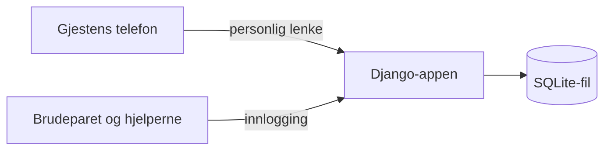
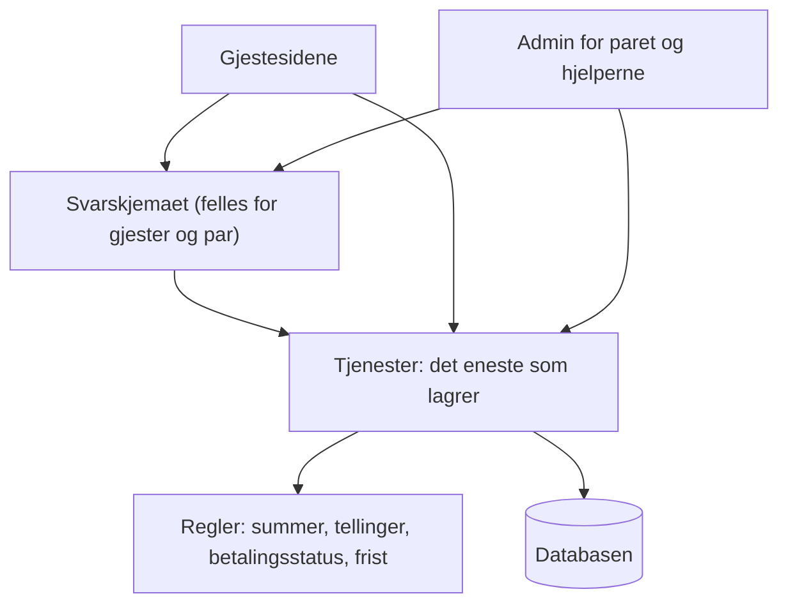
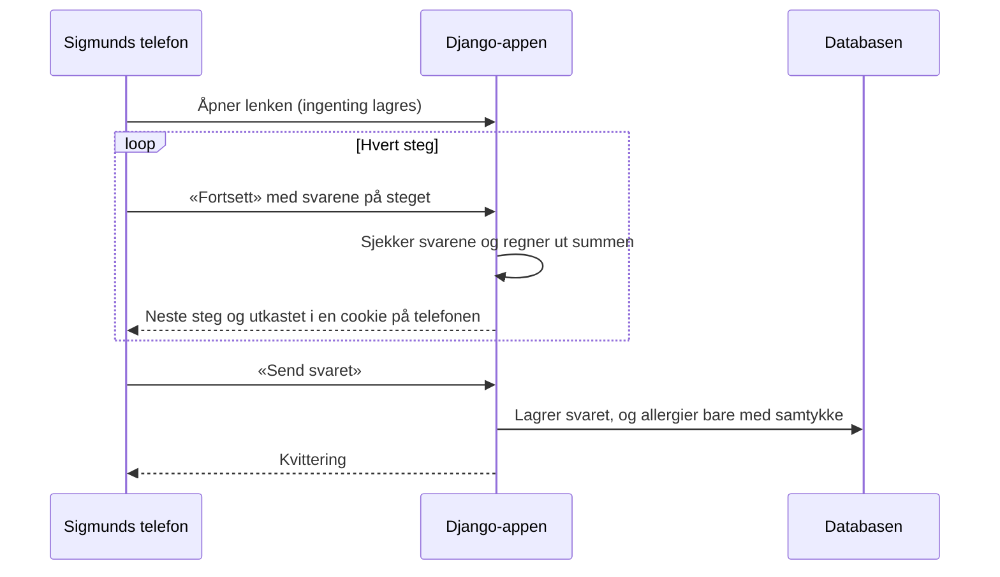

# Arkitekturen forklart

*AI'll handle it* · 16. november 2026

Dette er en kort forklaring på vanlig norsk av hvordan bryllupsnettsida er bygd opp, og hvorfor. Den er skrevet for faglærer, sensor og refleksjonsrapporten. Reglene som koden faktisk skal følge, står i [ARCHITECTURE-SPINE.md](ARCHITECTURE-SPINE.md). Begrunnelsen for hvert valg står i [memloggen](.memlog.md).

## Det store bildet

Nettsida er **ett program skrevet i Python med rammeverket Django**. Serveren lager ferdige nettsider og sender dem til telefonen. Det finnes ingen egen JavaScript-app og ingen egen databaseserver. Alle data ligger i én SQLite-fil.

## Hvorfor Django

Vi vurderte tre oppsett:

| | Django | FastAPI + Next.js (faglærers referanse) | Next.js alene |
|---|---|---|---|
| Antall programmer | Ett | To, i to språk | Ett |
| Innlogging, passord og skjemabeskyttelse | Innebygd | Må settes sammen | Må settes sammen |
| Sensor kjører det | Én installasjon, ingen database å sette opp | Python, Node, Docker og Postgres | Node |

Django ble valgt fordi det meste av sikkerheten følger med ferdig og godt testet. Det gir mindre KI-generert sikkerhetskode som må kvalitetssikres. Faglærers referanse er laget for en mye større nettbutikk. To gode prinsipper derfra er tatt med: appen kjører uten nøkler, og backup lagres utenfor huset.

## Hvordan koden er delt opp

Arkitekturen følger mønsteret **funksjonell kjerne, tynt skall**. Det viktigste er at alle regnereglene ligger på ett sted, uten database, så de kan testes direkte.

| Del | Hva den gjør | Hvorfor den er skilt ut |
|---|---|---|
| **Regler** | Regner ut summer, antall per måltid, betalingsstatus, allergistatus og om fristen er ute | Gjestesida og admin kan aldri regne ulikt, og testene kan sjekke tallene direkte |
| **Tjenester** | Lagrer alt, og noterer hvem som gjorde hva | Bare ett sted kan endre data, så ingen endring glipper |
| **Svarskjemaet** | Stegene gjesten går gjennom | Paret bruker nøyaktig samme skjema når de endrer et svar for en gjest (FR-63) |
| **Gjestesidene og admin** | Viser sidene | Holdes tynne, så logikken ikke spres |

## Når Sigmund svarer

- **Utkastet ligger på telefonen.** Hvis Sigmund blir avbrutt, er alt han har gått videre fra, der når han kommer tilbake (FR-78).
- **Ingenting lagres før «Send svaret».** Stegene går via serveren, men serveren lagrer ingenting før gjesten sender.
- **To i samme husstand kan ikke overskrive hverandre.** Hvis Marie har sendt et svar mens Sigmund fylte ut, får han se hennes svar før han kan sende (FR-38).
- **Det virker uten JavaScript.** Det er tryggere på gamle telefoner og i Messengers nettleser.

## Personvern i arkitekturen

- **Allergier** lagres bare med samtykke, og det gjelder også «Ingen allergier eller matbehov». I admin har hver gjest én av tre tilstander: *har allergier*, *ingen allergier* eller *ingen allergiopplysninger lagret*. Den siste samler med vilje «ikke svart», «svart uten samtykke» og «trukket samtykke». Å skille dem ville røpe at noen kanskje har et helsebehov.
- **Lenkekodene** er 22 tilfeldige tegn som ikke kan gjettes. De skrives ikke i loggene, og hjelperne ser dem aldri.
- **Gjestesidene** henter ingenting fra andre selskaper (fonter, skript), skjules for søkemotorer og sender ikke lenken videre til andre nettsteder.
- **Gjestene** ser bare hva de selv har meldt at de har betalt, aldri parets registreringer.

## Slik sikrer vi riktige tall

Rikkes viktigste krav er at nettsida *må virke*, og at tallene til Hardingasete må stemme. Derfor:

1. Det finnes en **forventet-resultat-liste**, regnet ut for hånd før koden skrives (FR-69).
2. Testdataene lages med de samme tjenestene som den ekte nettsida bruker. De er merket som testdata, så kommandoen kan kjøres på nytt og sletter bare det den selv har laget (AD-16, story 1.3).
3. De automatiske testene sjekker hvert tall, hver sum og hver betalingsstatus mot lista.
4. Hver telling er lengden av en liste med navn, så tallet og navnene bak det (FR-55) alltid stemmer.
5. Tester, linter og formatering kjører automatisk på GitHub ved hver push.

## Det som venter til 2027

| Hva | Når |
|---|---|
| Oppgradere til Django 6.2 LTS, fordi 6.1 mister sikkerhetsstøtte i desember 2027 ([issue #13](https://github.com/IBE160-2026/G26-dvergsdal/issues/13)) | Våren 2027 |
| Velge hosting i EU/EØS, med én server og lokal disk | Før 1. november 2027 |
| Daglig kryptert backup utenfor hostingkontoen, og øving på gjenoppretting | Sammen med hostingen |
| Redigerbare infosider for paret | 2027 |
| Avgjøre hvordan feil på den ekte nettsida skal nå paret | Sammen med hostingen |

## Hvordan KI ble styrt i arkitekturarbeidet

- **KI la fram alternativer, og Rikke valgte** der valget påvirker gjester, paret eller personvern: redigerbare infosider, utkastet med allergier, øktlengden i admin og samtykke for «Ingen allergier». Rene tekniske valg overlot hun til KI, og KI viste dem fram.
- **Rikke satte et vilkår som snudde en anbefaling.** KI mente først at «Ingen allergier» kunne lagres uten samtykke. Rikke svarte at det bare er greit hvis det følger personvernreglene. KI sjekket rettspraksis og byttet anbefaling.
- **Fem uavhengige KI-gjennomganger fant feil i KI-ens eget utkast**, og alle ble rettet ([reviews/](reviews/)). Blant dem var en feil påstand om personvern, en innstilling som ville stoppet alle skjemaer, og et svar som stille kunne slette samtykkede allergier.
- Alle valg med begrunnelse står i [memloggen](.memlog.md). Økta er logget i [sesjonsloggen](../../../../.logs/rikke/985-2026-11-16-09-15-23-arkitektur.md).
